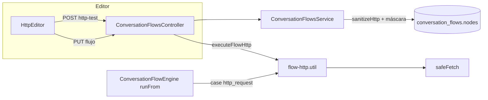
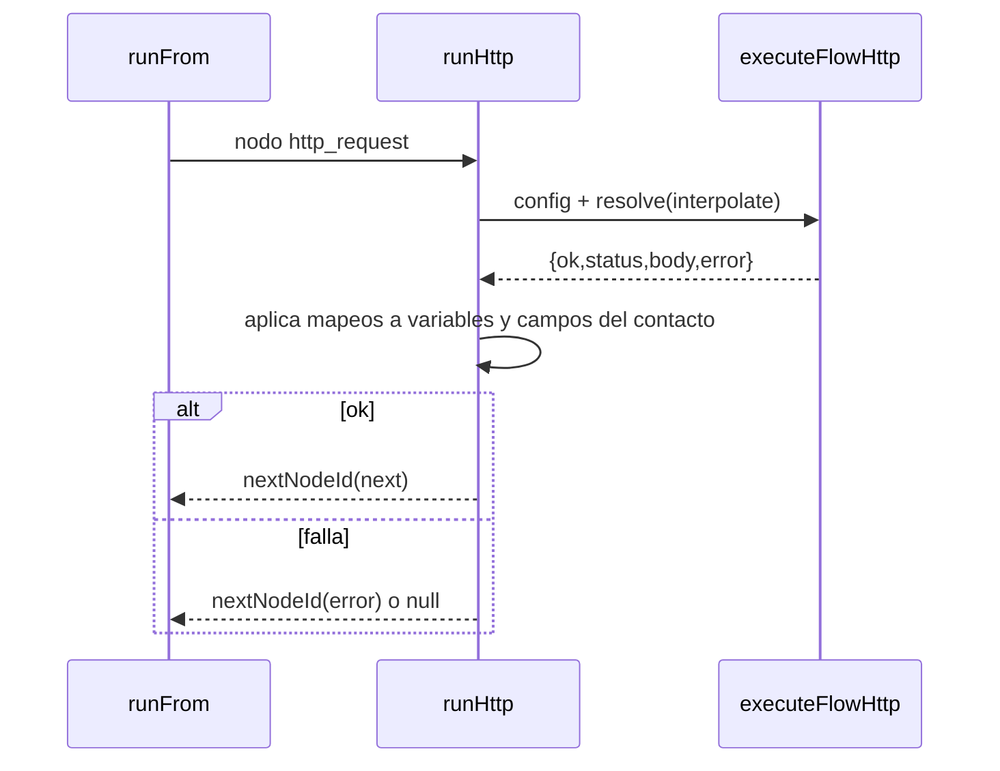

# Design Document

Nodo "Petición API" en flujos de conversación

## Overview

El nodo nuevo `http_request` sigue el patrón de `ai_generate`: corre de forma síncrona dentro del turno, no espera al contacto, guarda sus resultados en `variables` y tiene dos salidas, `next` ("Éxito") y `error` ("Si falla").

La lógica HTTP vive en un módulo puro, `flow-http.util.ts`. Lo usan dos consumidores: el motor (`conversation-flow.engine.ts`) cuando el flujo se ejecuta, y un endpoint de prueba que llama el editor. Así la prueba y la ejecución real hacen lo mismo.

Decisiones principales:
- **Reutilizar `safeFetch`** (`automatizaciones/utils/safe-fetch.util.ts`): bloqueo SSRF, sin redirecciones, límite de 1 MB. No se reutilizan las conexiones de Automatizaciones (decisión del usuario).
- **Las variables del flujo son `Record<string,string>`**, por eso todo valor mapeado se convierte a texto. Objetos y listas se guardan como JSON.
- **Rutas de respuesta** con `getPath` de `automatizaciones/utils/template.util.ts` (`a.b[0].c`). Ya bloquea `__proto__`, `constructor` y `prototype`. Limitación: no se pueden direccionar claves que contienen un punto.
- **Secretos en el JSON del flujo.** Para que no los lea cualquier miembro del tenant, los valores de encabezados sensibles se enmascaran al leer (ver Data Models).

## Architecture



Ejecución en el motor, dentro de `runFrom`:



## Components and Interfaces

### Backend

**`conversation-flow.entity.ts`**
- Agrega `'http_request'` a `FlowNodeType`.
- Agrega `http?: FlowHttpConfig` a `FlowNodeData`.

**`flow-http.util.ts`** (nuevo, sin dependencias de Nest)
```ts
export const HTTP_RESERVED_VARIABLES = ['http_status', 'http_error'];
export const HTTP_MAX_TURN_MS = 30_000;
export const HTTP_MAX_TIMEOUT_SEC = 15;
export const HTTP_DEFAULT_TIMEOUT_SEC = 10;
export const HTTP_MAX_VALUE_CHARS = 4000;

/** Sustituye {{x}} en texto. El motor pasa su interpolate; la prueba, un mapa de valores. */
export type Resolve = (text: string) => string;

export interface HttpOutcome {
  ok: boolean;            // 2xx
  status: number;         // 0 si no hubo respuesta
  durationMs: number;
  body?: unknown;         // JSON ya parseado o texto
  error?: string;         // mensaje corto en español
}

export function executeFlowHttp(
  cfg: FlowHttpConfig,
  resolve: Resolve,
  opts?: { fetcher?: typeof safeFetch; budgetMs?: number },
): Promise<HttpOutcome>;

/** Aplica los mapeos. Devuelve valores (texto) y las rutas que no existieron. */
export function applyMappings(
  mappings: FlowHttpMapping[],
  body: unknown,
): { values: Record<string, string>; missing: string[] };

export function isSensitiveHeader(name: string): boolean;
export const MASKED_HEADER_VALUE: string; // '__saved__'
```

Reglas de `executeFlowHttp`:
1. **URL:** se resuelve con `{{x}}` codificado (`encodeURIComponent`, igual que `interpolateUrl`). Los parámetros de `query` se agregan con `URLSearchParams`, que también codifica.
2. **Encabezados:** nombre y valor se resuelven. No se codifican, pero se rechazan valores con `\r` o `\n`.
3. **Cuerpo:**
   - `json`: si el texto es JSON válido, se recorren sus strings y se sustituye `{{x}}` por valor; luego `JSON.stringify`. Un valor con comillas no rompe el JSON. Si no es JSON válido, se sustituye como texto.
   - `form`: `URLSearchParams` con los pares resueltos.
   - `text`: texto resuelto.
4. **Tiempo:** `timeoutMs = min(cfg.timeoutSec ?? 10, 15) * 1000`, recortado por `budgetMs` (lo que queda del presupuesto del turno). Con `budgetMs <= 0` no hace la llamada y devuelve `{ok:false,status:0,error:'Tiempo total del turno agotado'}`.
5. **Errores:** nunca lanza. Traduce las excepciones de `safeFetch` a mensajes cortos (`Tiempo agotado`, `URL no permitida`, `No se pudo conectar`) y los estados no 2xx a `HTTP <status>`.

**`conversation-flow.engine.ts`**
- Nuevo `case 'http_request'` en `runFrom` que llama a `runHttp(...)`.
- `FlowRunResult` suma `httpMs: number` (acumulado del turno). `emptyResult` lo inicia en 0. El presupuesto es `HTTP_MAX_TURN_MS - result.httpMs`.
- `runHttp`:
  - Sin URL: `failed('El nodo no tiene URL')`.
  - Llama a `executeFlowHttp(cfg, (t) => this.interpolate(t, variables, context))` y suma `durationMs` a `result.httpMs`.
  - Siempre fija `variables.http_status = String(status)`.
  - Si `ok`: aplica los mapeos. Cada variable se guarda recortada a 4000 caracteres, y si el mapeo tiene `saveToField` se llama a `queueContactUpdate(..., keepExisting)`. Una ruta que no existe ejecuta `delete variables[nombre]`. Borra `http_error`. Sigue por `next`.
  - Si falla: `variables.http_error = error`. Sigue por `error`. **Sin salida `error` conectada, devuelve `null`**: el flujo termina (el bucle ya deja `result.state = null`) y se escribe `console.warn` con flujo, nodo y motivo. Es distinto de `runGenerate`, que cae a `next`, porque aquí seguir por "Éxito" sin datos sería engañoso.
  - Los mapeos no se aplican cuando la respuesta no es 2xx.
- El cuerpo de la respuesta no se registra. El `console.warn` solo incluye método, host, estado y motivo.

**`conversation-flows.service.ts`**
- `NODE_TYPES` suma `'http_request'`.
- `isValidHandle`: `case 'http_request': return handle === 'next' || handle === 'error'`.
- `sanitizeNodes`: nuevo `case 'http_request'` → `node.data.http = this.sanitizeHttp(d.http, existingNode, customKeys)`.
- `sanitizeHttp(raw, existing, customKeys)`:
  - `method` en {GET, POST, PUT, PATCH, DELETE}, por defecto GET.
  - `url` ≤ 2000 caracteres. `query`, `headers`, `formFields`: máximo 20 pares; clave ≤ 100, valor ≤ 2000.
  - Nombres de encabezado válidos (`/^[A-Za-z0-9!#$%&'*+.^_`|~-]+$/`). Se descartan `Host`, `Content-Length`, `Transfer-Encoding` y `Connection`.
  - `bodyType` en {none, json, form, text}; `body` ≤ 10 000 caracteres. Con GET, `bodyType = 'none'`.
  - `timeoutSec` entre 1 y 15.
  - `mappings`: máximo 30. `variable` con `/^\w{1,50}$/`, distinta de `http_status` y `http_error`, sin repetirse. `path` ≤ 200 caracteres. `saveToField` solo si es un campo escribible, con la misma validación que `sanitizeGenerate`.
  - **Máscara al guardar:** si el valor de un encabezado sensible es `MASKED_HEADER_VALUE`, se reemplaza por el valor del mismo encabezado (mismo nombre, sin distinguir mayúsculas) en el nodo guardado antes. Si no existía, se descarta el encabezado.
- **Máscara al leer:** `findOne`, `create`, `update` y cualquier respuesta con `nodes` pasan por `maskFlow()`, que reemplaza el valor de los encabezados sensibles de nodos `http_request` por `MASKED_HEADER_VALUE`. La copia que va a la base de datos nunca se enmascara. El motor lee de la entidad, no de la respuesta de la API.

**`conversation-flows.controller.ts`**
```ts
@Post('http-test')
@Throttle({ medium: { limit: 20, ttl: 60_000 } })
httpTest(@Body() dto: HttpTestDto) { return this.flows.testHttp(dto); }
```
- Va antes de las rutas `:id`. Hereda `JwtAuthGuard` y `TenantAccessGuard` (exige `tenantId` en el body).
- `HttpTestDto`: `{ tenantId, flowId?, nodeId?, config: FlowHttpConfig, values: Record<string,string> }`.
- `testHttp`: pasa `config` por `sanitizeHttp` (con el nodo guardado si hay `flowId` y `nodeId`, para resolver los encabezados enmascarados). Ejecuta `executeFlowHttp` con `resolve` = reemplazo de `{{x}}` desde `values` (faltantes → texto vacío). No toca el flujo, la conversación ni el contacto.
- Respuesta: `{ ok, status, durationMs, contentType, body, truncated, error }`. `body` se recorta a 256 KB. Si el recorte parte un JSON, se devuelve como texto y `truncated = true`. No se devuelven los encabezados de respuesta.
- No se guarda nada de la respuesta. El log solo tiene tenant, host, estado y duración.

### Frontend (`frontend/src/pages/comunicaciones/flujos/`)

| Archivo | Cambio |
|---|---|
| `types.ts` | `FlowNodeType += "http_request"`, `FlowHttpConfig`, `FlowHttpMapping`, `data.http`, etiqueta "Petición API" |
| `http.ts` (nuevo) | `defaultHttpConfig()`, `httpIssue(cfg)`, `httpVariables(cfg)`, `extractPlaceholders(cfg)`, `flattenJson`, `suggestVariableName(path)`, `getPath` espejo del backend |
| `HttpEditor.tsx` (nuevo) | Panel del nodo (ver abajo) |
| `JsonTree.tsx` (nuevo) | Árbol navegable; pulsar una hoja dispara `onPick(path, value)` |
| `FlowNodes.tsx` | `HttpNode`: cabecera con icono `Globe`, `METHOD host/ruta`, chips de las variables mapeadas, salidas "Éxito" y "Si falla" |
| `nodeTypes.ts` | `http_request: HttpNode` |
| `FlujoEditor.tsx` | Paleta ("Petición API"), datos por defecto, `handles` `{next, error}`, variables disponibles para nodos posteriores (`http_status`, `http_error` y las mapeadas) |
| `NodeInspector.tsx` | `{type === "http_request" && <HttpEditor .../>}` |

**`HttpEditor`** tiene tres secciones:
1. **Petición:** selector de método, URL con `VariableField`. Pestañas Parámetros, Encabezados y Cuerpo (el cuerpo se oculta con GET). Los valores de encabezados sensibles usan `<input type="password">` con botón para revelar. Un valor guardado llega como `__saved__` y se muestra como "Valor guardado" con el botón "Reemplazar". Tiempo de espera numérico (1–15).
2. **Probar:**
   - Botón "Probar". Antes se buscan los `{{x}}` de la configuración con `extractPlaceholders`. Para cada uno aparece un campo de valor de ejemplo (se guardan en estado del editor, no en el flujo).
   - Si el método no es GET, abre `ConfirmModal` (`variant="warning"`) avisando que la petición puede crear o modificar datos reales.
   - Llama a `POST /conversation-flows/http-test`. Muestra estado, tiempo y el cuerpo con `JsonTree`. Un error se muestra en el mismo panel.
   - La respuesta vive en `useState` del componente. No se guarda en el flujo y se pierde al cerrar el editor.
3. **Guardar respuesta:** lista de mapeos (ruta, variable, campo del CRM opcional). Pulsar una hoja del árbol agrega un mapeo con la ruta y un nombre sugerido (`suggestVariableName`: última clave, minúsculas, sin caracteres no válidos, único). Cada mapeo muestra el valor que tomaría con la última respuesta de prueba, calculado con `getPath` en el cliente. Un botón agrega la ruta `$` (respuesta completa).

`httpIssue` marca el nodo con advertencia si falta la URL, si la URL no empieza por `http`, o si un mapeo no tiene variable.

## Data Models

```ts
export type FlowHttpMethod = 'GET' | 'POST' | 'PUT' | 'PATCH' | 'DELETE';
export interface FlowHttpPair { key: string; value: string }

export interface FlowHttpMapping {
  id: string;                 // estable, para la UI
  path: string;               // 'data.items[0].nombre' o '$' (respuesta completa)
  variable: string;           // /^\w{1,50}$/
  saveToField?: string;       // campo del CRM
  keepExisting?: boolean;
}

export interface FlowHttpConfig {
  method: FlowHttpMethod;
  url: string;                // admite {{x}} (codificado en la URL)
  query?: FlowHttpPair[];
  headers?: FlowHttpPair[];   // valor sensible enmascarado en lecturas de la API
  bodyType?: 'none' | 'json' | 'form' | 'text';
  body?: string;
  formFields?: FlowHttpPair[];
  timeoutSec?: number;        // 1–15, por defecto 10
  mappings?: FlowHttpMapping[];
}
```

- Se guarda dentro de `nodes[].data.http` (JSONB de `conversation_flows`). **No hay migración.**
- Un encabezado es sensible si su nombre, sin distinguir mayúsculas, es `authorization`, `cookie` o `proxy-authorization`, o contiene `token`, `key`, `secret` o `auth`.
- Variables que escribe el nodo: las de `mappings[].variable`, `http_status` (siempre) y `http_error` (solo si falla; se borra si funciona).
- Valores guardados como texto, máximo 4000 caracteres. Booleanos y números con `String()`. Objetos y listas con `JSON.stringify`.

## Error Handling

| Situación | Resultado |
|---|---|
| Estado 2xx | Mapeos aplicados, `http_status` fijado, `http_error` borrado, salida `next` |
| Estado 3xx, 4xx o 5xx | `http_status` fijado, `http_error = 'HTTP <status>'`, salida `error`, mapeos no aplicados |
| Tiempo agotado, DNS o conexión | `http_status = '0'`, `http_error` con el motivo, salida `error` |
| URL privada o no http(s) | `http_status = '0'`, `http_error = 'URL no permitida'`, salida `error` |
| Presupuesto del turno agotado (30 s) | No se llama a la API. `http_error = 'Tiempo total del turno agotado'`, salida `error` |
| Sin URL en el nodo | `http_error = 'El nodo no tiene URL'`, salida `error` |
| Salida `error` sin conectar | El flujo termina y se registra una advertencia |
| Ruta de mapeo ausente en la respuesta | La variable se elimina; el flujo sigue por `next` |
| Respuesta no JSON con ruta distinta de `$` | La variable se elimina |
| Endpoint de prueba con error | HTTP 200 con `ok: false` y `error`. Solo se devuelven 4xx por datos de entrada inválidos o falta de acceso |
| Más de 20 pruebas por minuto | 429 de `ThrottlerGuard` |

## Testing Strategy

Backend con Jest, en el estilo de `flow-generate.spec.ts` y `flow-send-template.spec.ts`:

- **`flow-http.util.spec.ts`**
  - `executeFlowHttp` con un `fetcher` simulado: método, URL con parámetros codificados, `{{x}}` con espacios o `&` en la URL, JSON con comillas y saltos de línea en un valor, formulario, encabezados con `\n` rechazados, tiempo máximo de 15 s, presupuesto agotado.
  - `applyMappings`: ruta anidada, índice de lista, ruta ausente, `$`, objeto a JSON, recorte a 4000, claves `__proto__`.
  - `isSensitiveHeader` y máscara: `Authorization`, `X-Api-Key`, `X-Custom-Token`, y uno no sensible (`Content-Type`).
- **`flow-http-node.spec.ts`** (motor, con `fetcher` simulado)
  - Éxito: variables y `http_status` disponibles para una Condición y un Mensaje posteriores.
  - Error con salida `error` conectada, y sin conectar (el flujo termina).
  - Dos nodos seguidos con presupuesto agotado.
  - `saveToField` y `keepExisting` generan `contactUpdates`.
  - Una ruta ausente borra el valor de una ejecución anterior.
  - Flujos sin el nodo se comportan igual (los specs existentes siguen pasando).
- **Servicio:** `sanitizeHttp` (método inválido, encabezados prohibidos, variable reservada, duplicados, límites), máscara al leer y valor conservado al guardar con `__saved__`, `isValidHandle`.
- **Endpoint de prueba:** rechaza `localhost` y `169.254.169.254`, requiere `tenantId` y acceso, no modifica el flujo, no devuelve el secreto guardado.

Frontend: `tsc` y lint, más pruebas manuales en el editor: crear el nodo, probar una API real (GET y POST con confirmación), mapear campos tocando el árbol, conectar un Mensaje que use `{{variable}}`, guardar, recargar y comprobar que el token aparece como "Valor guardado". No hay pruebas automatizadas de componentes en el frontend para este módulo.

Despliegue: sin migración. El orden es backend primero, porque un flujo guardado con el nodo nuevo falla en servidores que aún no lo reconocen.

## Correctness Properties

### Property 1: Prueba y ejecución coinciden

Para la misma configuración y los mismos valores, la petición que arma el endpoint de prueba es idéntica a la que arma el motor (ambos usan `executeFlowHttp`).

**Validates: Requirements 4.1**

### Property 2: JSON siempre válido

Si el cuerpo es una plantilla JSON válida, el cuerpo enviado es JSON válido para cualquier valor de variable.

**Validates: Requirements 1.5**

### Property 3: Sin efectos en la prueba

El endpoint de prueba no modifica el flujo, la conversación ni el contacto.

**Validates: Requirements 4.8**

### Property 4: Sin secretos en respuestas de la API

Ninguna respuesta de la API de flujos contiene el valor de un encabezado sensible.

**Validates: Requirements 5.5**

### Property 5: Conservación del secreto

Guardar un flujo con `__saved__` en un encabezado sensible deja intacto el valor almacenado.

**Validates: Requirements 1.7**

### Property 6: Sin valores obsoletos

Tras ejecutar el nodo, una variable mapeada solo existe si su ruta existió en la respuesta de esa ejecución.

**Validates: Requirements 2.3**

### Property 7: Mapeos solo con éxito

Con estado distinto de 2xx no se escribe ninguna variable mapeada ni campo del contacto.

**Validates: Requirements 2.2, 3.3**

### Property 8: Tiempo acotado

La suma del tiempo de las peticiones de un turno no supera 30 s más el tiempo de la última petición en curso (máximo 15 s).

**Validates: Requirements 5.2, 5.6**

## Riesgos y límites conocidos

- **Resolución DNS:** `assertPublicUrl` resuelve el host antes del `fetch`, y `fetch` vuelve a resolverlo. Un DNS que cambie entre ambas consultas podría saltarse el bloqueo (DNS rebinding). Ya existe en Automatizaciones y queda fuera de este spec.
- **Latencia:** una API lenta retrasa la respuesta al contacto. Los límites son 15 s por nodo y 30 s por turno.
- **Datos personales:** al probar con datos reales, la respuesta pasa por el navegador del editor. No se guarda en el servidor.
- **Claves con punto:** una clave JSON como `"a.b"` no se puede mapear con `getPath`.
